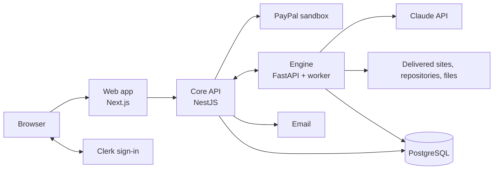
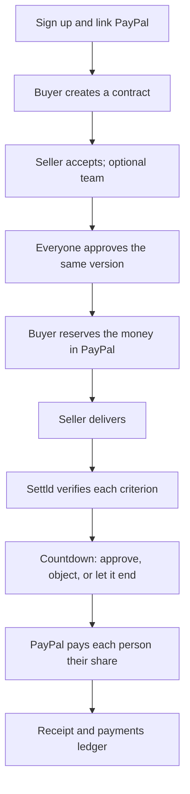
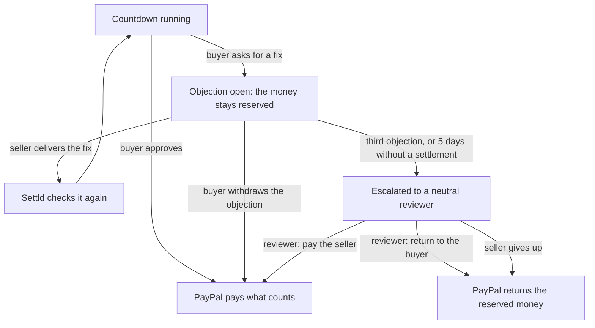

# Settld

**Work verified. Money settled.**

Settld is a referee for paid work. A buyer and a seller agree on what "done" means before any work starts. PayPal reserves the buyer's money, Settld checks the delivery against each agreed criterion, and PayPal pays each person on the team their share of what passed. Settld never holds the money.

| | |
|---|---|
| **Live demo** | <https://settld.altamiratechlabs.com> (PayPal **sandbox**: no real money moves) |
| **Demo video** | <https://youtu.be/U7yK8hcebUU> (2:53): one $10 contract from agreement to a partial PayPal capture |
| **Built for** | [PayPal AI Hackathon](https://paypalaihackathon.devpost.com), from 2026-10-08 ([development history](docs/development-history.md)) |
| **Built with** | PayPal Orders v2 and Payments v2, PayPal Partner Referrals, Claude API, AG Grid Community, Clerk, Next.js, NestJS, FastAPI, PostgreSQL |
| **License** | [Apache License 2.0](LICENSE) |
| **Fastest way to evaluate** | [Judge guide](#6-judge-and-evaluator-guide), about 10–15 minutes. Longer versions: [Judges' guide](docs/judges-guide.md) and [Devpost submission](docs/devpost-submission.md) |

## Contents

1. [Overview](#1-overview)
2. [What works today](#2-what-works-today)
3. [How Settld uses PayPal and AI](#3-how-settld-uses-paypal-and-ai)
4. [Architecture](#4-architecture)
5. [Roles and workflows](#5-roles-and-workflows)
6. [Judge and evaluator guide](#6-judge-and-evaluator-guide)
7. [Getting started locally](#7-getting-started-locally)
8. [Known limitations](#8-known-limitations)
9. [Future improvements](#9-future-improvements)
10. [Repository, license and disclaimer](#10-repository-license-and-disclaimer)

---

## 1. Overview

### The problem

Paying for freelance work means someone takes a risk:

- **If the buyer pays first,** the work may never arrive.
- **If the seller delivers first,** the money may never arrive.
- **"Done" is a matter of opinion,** so a small gap at the end turns into a dispute over the whole amount.
- **Teams make it worse.** The seller collects everything and pays collaborators afterwards, so the collaborators carry everyone's risk.

### The solution

1. **Agree.** The buyer describes the work. Claude drafts checkable criteria, each with a share of the payment, and flags vague words such as "fast". Every party approves the same locked version.
2. **Reserve.** The buyer approves the payment in PayPal. The money is **authorized, not captured**: it stays in the buyer's PayPal account.
3. **Deliver.** The seller submits something checkable: a link, a public GitHub repository, or a `.zip` file.
4. **Verify.** Automatic checks and an AI evaluator check each criterion and record the evidence.
5. **Decide.** A visible countdown opens. The buyer can approve, ask for a fix, or let it run out. An AI verdict alone never releases money.
6. **Release.** PayPal captures only the share that was earned and pays each team member directly. The rest stays reserved or returns to the buyer.

### Who it is for

| User | What they get |
|---|---|
| **Buyers** | Pay for criteria that passed, not for promises |
| **Sellers** | Know what "done" means before starting, and get paid for what passed instead of all or nothing |
| **Collaborators** | Get their share straight from PayPal on every release |
| **Reviewers ("Settlers")** | Neutral people who rule on disputes the buyer and seller could not settle |

---

## 2. What works today

Every feature below is in one of three states. Only the first is presented as operational.

**How it was verified (2026-11-09, commit on `main` deployed to the live demo):**
- **Automated tests:** web 300 passed; Core API 231 unit tests passed and 330 end-to-end tests passed; Engine 226 passed (68 database tests skipped in that run).
- **End-to-end runs against the PayPal sandbox** on a local deployment, on 2026-11-05 and 2026-11-07, with the demo accounts.
- **Live demo:** the full signed-in journey ran end to end on the live demo on 2026-11-11, with the demo accounts and the PayPal sandbox: a contract with weighted criteria, the invitation email, the team split, the locked agreement, the PayPal authorization, a GitHub delivery, the AI audit, a partial capture paid to two team members, the receipt and the ledger. The [demo video](https://youtu.be/U7yK8hcebUU) shows that run. Objections and the reviewer flow have not been run there.

### Implemented and verified

| Feature | What it does | Evidence |
|---|---|---|
| **Onboarding with PayPal** | Each person picks a role and links PayPal: buyers with Log in with PayPal, sellers and collaborators by connecting their PayPal Business account | Tests; sandbox runs |
| **AI contract compiler** | Turns a description into weighted, checkable criteria and suggests measurable rewrites of vague words. Up to 20 suggestions per user per day | Tests (model stubbed) |
| **Locked agreements** | Every party approves the same version, identified by a SHA-256 fingerprint. Any change creates a new version that everyone approves again | Tests |
| **Team splits** | A seller adds up to four collaborators. Shares total exactly 100% | Tests; sandbox runs |
| **PayPal funding** | One PayPal authorization per team member, so PayPal pays each person directly. The buyer goes from one PayPal approval to the next in a single flow | Tests; sandbox runs |
| **Automatic check** | An HTTP check that a public HTTPS address answers | Tests; sandbox runs |
| **AI evaluator** | Judges criteria that need reading: a delivered site (several pages), a public GitHub repository at the delivered commit, or a `.zip` with text, code, PDF or image files. Each check has a verdict, its evidence, and what to fix | Tests; 16 of 16 cases with the real model ([summary](docs/ai-evaluation.md)) |
| **Manipulation flag** | Delivered content that tries to instruct the AI is treated as data, flagged, and quoted to the buyer | Tests; 4 manipulation cases in the evaluation |
| **Proportional release** | Each criterion pays its weight when it counts. Required criteria must pass before anything is paid. Paid + still held + returned always equals what was funded | Tests, including money-invariant tests |
| **Countdown and decision** | A countdown of at least 60 seconds before money moves. The buyer approves, objects, or lets it end | Tests; sandbox runs |
| **Objections and neutral reviewers** | The buyer asks for a fix. The third objection on a milestone, or five days without a settlement, goes to a neutral reviewer, who rules to pay or return the money. See [When the buyer and seller disagree](#when-the-buyer-and-seller-disagree) | Tests; not yet run on the live demo |
| **Open projects** | A buyer publishes a contract for any seller to take, listed for 30 days | Tests |
| **Settlement receipt** | Per milestone: funded, paid, still held, returned, who was paid, and the PayPal capture ids | Code; sandbox runs |
| **Payments ledger (AG Grid)** | Every PayPal fact across contracts, with filters, totals per currency, a detail panel, and CSV export | Tests; checked in the browser |
| **Criteria editor and "Who gets what" (AG Grid)** | Edit criteria as a table; see each member's part of every milestone (a collaborator sees only their own) | Tests; checked in the browser |
| **Email notifications** | Invitations, locked agreements, countdowns, decisions, objections and rulings, in English and Spanish. Each email is sent once, even if a job runs twice | Tests; working in production on the live demo |

### Implemented, not fully verified

| Feature | Status |
|---|---|
| **Release countdown and reviewer queue grids (AG Grid)** | Covered by unit and component tests, and seen with sample data. Not yet seen with live data. (The AI audit grid ran with live data on the live demo on 2026-11-11.) |

### Planned

See [Future improvements](#9-future-improvements). Nothing in that section exists in the product today.

---

## 3. How Settld uses PayPal and AI

### PayPal moves the money

Settld never holds funds. It only tells PayPal when to move them.

| Capability | PayPal API | Used for |
|---|---|---|
| Authorize now, capture later | Orders v2 (`intent: AUTHORIZE`) | Reserving the payment without taking it |
| Partial capture | Payments v2 | Paying only for the criteria that counted |
| Void and refund | Payments v2 | Returning what was not earned |
| Seller onboarding | Partner Referrals | Connecting each payee's own PayPal account |
| Log in with PayPal | Identity | Linking the buyer's PayPal account |
| Safe retries | `PayPal-Request-Id` | A retry can never capture twice |

### Claude reads, people decide

Claude has two jobs, both through the Anthropic API with structured outputs:

- **Contract compiler** (`claude-sonnet-5-5`): drafts criteria with a share of the payment each, and flags terms that cannot be checked.
- **Evaluator agent** (`claude-opus-5-5`): reads the delivery for criteria a deterministic check cannot decide, such as "the pricing page lists the three plans".

What the buyer and seller can rely on:
- The AI reads only the sources named in the agreement and the delivery.
- Every read is fingerprinted with SHA-256 and listed in the **What the AI checked** grid, so both sides see exactly what the verdict rests on.
- A verdict without its own evidence is downgraded to "not sure".
- **An AI verdict never moves money.** An AI-judged criterion counts only after the buyer approves it.

Measured results: [docs/ai-evaluation.md](docs/ai-evaluation.md).

---

## 4. Architecture



| Component | Responsibility | Technology |
|---|---|---|
| **Web app** | Every screen: onboarding, contracts, funding, delivery, review, receipts, ledger | Next.js 16, React 19, Tailwind CSS 4, AG Grid Community |
| **Core API** | Accounts, contracts and versions, the milestone state machine, PayPal calls, objections, notifications, durable timers | NestJS, Drizzle ORM, pg-boss, Zod |
| **Engine** | Verification runs: automatic checks and the AI evaluator | FastAPI, SQLAlchemy, Procrastinate, Anthropic SDK |
| **Database** | Contracts, payments, verification results, jobs | PostgreSQL 18 |
| **External services** | Payments; sign-in; AI; email | PayPal sandbox; Clerk; Claude API; SMTP |

**Deployment (live demo):** the web app runs on Vercel. Core API, the Engine, its worker and PostgreSQL run in one container on a single cloud server. PayPal runs in sandbox mode and Clerk as a development instance.

**Reliability:** timers and jobs are stored in PostgreSQL, so a restart does not lose a pending release, and PayPal calls carry idempotency keys so a retry cannot pay twice.

---

## 5. Roles and workflows

| Role | How you get it | What it can do |
|---|---|---|
| **Buyer** | "I want to hire" or "Both" in onboarding | Create contracts, invite a seller or publish an open project, fund milestones, approve or object, cancel a milestone |
| **Seller** | "I want to get paid" or "Both" | Accept invitations or take open projects, build the team, deliver, answer objections, accept a partial payment |
| **Collaborator** | "I join teams"; a seller adds them | See the contract and only their own share, approve the version, get paid directly |
| **Reviewer** | Apply in onboarding or on Profile; an admin approves | Rule on escalated objections, only on contracts they are not part of |
| **Admin** | Not available in the demo | Decide reviewer applications |

### The main journey



### When the buyer and seller disagree

The AI never settles a dispute. Every disagreement ends with a decision by a person, and the money stays reserved in the buyer's PayPal account until then: nothing is captured while a case is open.

Most disagreements never become disputes. When only part of the work passes, the buyer can approve that part, and the seller either fixes the rest or accepts the partial payment.



| Step | Who | What happens |
|---|---|---|
| **Ask for a fix** | Buyer, during the countdown | **Ask the seller to fix it**: tick the criteria that are not done and give a reason of at least 20 characters. Nothing is paid |
| **Fix** | Seller | **Deliver the fix**. Settld verifies the new delivery, and a new countdown follows |
| **Withdraw** | Buyer | **Withdraw the objection and release**: what counts is paid |
| **Escalate** | Automatic | The buyer's **third objection** on the same milestone, or **five days** without a settlement, sends the case to a neutral reviewer: "A neutral reviewer will decide this. The money stays reserved until then." From then on the seller cannot answer by delivering again |
| **Rule** | Reviewer | In **Objections to review**, an AG Grid queue with the waiting time and the amount held, the reviewer opens the case, chooses **Pay $X to the seller** or **Return $X to the buyer**, and records a reason of at least 20 characters. PayPal then pays or returns the reserved money |
| **Give up** | Seller, after an escalation | **Return everything to the buyer**, or **Keep what was paid and return the rest** |

**Who the reviewers are.** Reviewers, called "Settlers" in the app, are people, not AI. Anyone can apply, with the "Be a Settler" box in onboarding or **Apply to be a Settler** on Profile. An admin approves each application, and an applicant has no reviewer permissions until then. A reviewer only sees cases on contracts they are not part of; anyone else who opens `/review` gets "not found".

**Status.** Built and covered by tests, but not yet run on the live demo. There is no admin login for the demo, so judges cannot approve a reviewer themselves. Assigning a reviewer to a specific dispute, and paying reviewers, are planned, not built. To try it: [Test scenarios](#test-scenarios) P-6 to P-9 and R-1 to R-4.

### AG Grid walkthrough: six grids

Settld uses AG Grid Community for five views inside the workflow and for the payments ledger. The grids only display data; none of them moves money or makes a decision. A grid appears once there is data for it.

| View | Where it is | Question it answers | Role | Data it needs |
|---|---|---|---|---|
| **Criteria editor**, Table mode | **New contract** → "Milestones" → **Criteria as: Table** (the default is **Cards**; not shown on narrow screens) | What must pass, and what share of the payment does each criterion carry? | Buyer, or a seller editing a draft | A draft milestone. Each row has a code such as `M1-C2` |
| **What the AI checked** | Contract page → the milestone | What did the AI check, with which evidence, and did anything try to manipulate it? | Every party | A delivery checked against an AI criterion. Shows "Checking…" while the AI reads. Select a row for "From the agreement", "What the AI found", "What the seller must fix", and "What it read", each with its SHA-256 |
| **Money about to move** | **Dashboard**, during a countdown | Which payments are about to be released, how much, to whom, and how long is left? | Buyer, seller, collaborator | A delivery whose countdown is running. Choose a 1-minute countdown to see it reach zero |
| **Who gets what** | Contract page, under the milestones | What is each member's part of every milestone, and what was paid? | Buyer and seller see every row; a collaborator sees only their own | A contract with at least one collaborator |
| **Objections to review** | `/review`, or **Objections to review** on the dashboard | Which disputes are waiting for a neutral ruling, for how long, and how much is held? | An approved reviewer who is not a party to the contract; anyone else gets "not found" | An escalated objection: the buyer's third objection on the same milestone, or five days without a settlement |
| **Payments** ledger | **Payments** in the top menu | What did PayPal authorize, capture, void or refund, for which criteria, with which PayPal id? | Any party, for their own contracts | A reservation or a release. Match each id with the **Settlement receipt** and the PayPal sandbox account |

**How the countdown keeps time.** Countdowns count from the server's time when the page was rendered, plus the time elapsed on the browser's monotonic clock, so a wrong computer clock cannot make one end early or late. At zero it shows **Confirming…** instead of "Paid", because only the server releases money: the page asks the server, and the row disappears once the server has closed the window.

---

## 6. Judge and evaluator guide

This section is the short version. The [Judges' guide](docs/judges-guide.md) adds every demo account, roles and permissions, and a step-by-step local setup; the [Devpost submission](docs/devpost-submission.md) is the text submitted to the hackathon.

### Before you start

| Item | Value |
|---|---|
| **Demo URL** | <https://settld.altamiratechlabs.com> |
| **Payments** | PayPal **sandbox** only. No real money moves |
| **Sign-in** | Clerk **development** instance, so the sign-in page shows a "Development mode" badge. This is expected |
| **Email codes** | Any address containing `+clerk_test` receives no real email; its code is always `424242` |

### Demo accounts

Completing a flow needs a **Settld login** and a **PayPal sandbox account** to pay or get paid. The logins follow the pattern `altamiratechlabs+clerk_test_<user>@gmail.com` with the code `424242`.

| Settld login | Name | Role | PayPal sandbox account |
|---|---|---|---|
| `altamiratechlabs+clerk_test_buyer_1@gmail.com` | Emily Carter | Buyer | `settld_buyer_1@personal.example.com` (Personal) |
| `altamiratechlabs+clerk_test_buyer_3@gmail.com` | Laura Bennett | Buyer | `settld_buyer_3@personal.example.com` (Personal) |
| `altamiratechlabs+clerk_test_seller_2@gmail.com` | Priya Shah | Seller | `settld_seller_2@business.example.com` (Business) |
| `altamiratechlabs+clerk_test_seller_3@gmail.com` | Tom Alvarez | Seller | `settld_seller_3@business.example.com` (Business) |
| `altamiratechlabs+clerk_test_collab_2@gmail.com` | Andres Gomez | Collaborator | `settld_collaborator_2@business.example.com` (Business) |
| `altamiratechlabs+clerk_test_collab_3@gmail.com` | Hannah Brooks | Collaborator | `settld_collaborator_3@business.example.com` (Business) |

**Passwords are not in this repository.** They are in the testing instructions of the Devpost submission. The people in these profiles are invented.

You can also sign up with any `+clerk_test` address and the code `424242`. To pay or get paid you still need one of the PayPal sandbox accounts above.

### Recommended 10–15 minute test

Use two browser windows (a normal one and a private one): the buyer `buyer_1` in one, the seller `seller_2` in the other. Add `collab_2` in a third browser to see the team split.

1. **Buyer:** **New contract**. Title `Landing page`, currency USD. Milestone "What gets delivered" `Published page`, amount `10.00`, a future due date. Select **Criteria as: Table** and add:

   | Criterion | Level | Check | Settings | Weight |
   |---|---|---|---|---|
   | `The page answers 200` | Automatic | A URL answers (HTTP probe) | URL `https://example.com` | 70 |
   | `The page explains what it is for` | AI check | Requirement is met | "What the AI should look for": `The page clearly says what the domain is for` | 30 |

   "Release countdown" **1 minute**. **Invite a seller by email** with the seller's login, then **Create and send invitation**.
2. **Seller:** on the dashboard, **See it** → **Accept invitation**. Optional: **Edit team** → **Add from the directory** → add the collaborator, shares 70 / 30 → **Save team**.
3. **Buyer:** **Submit for approval**. Then every party selects **Approve version N**. Expected: "Agreed by both parties. This version can no longer change."
4. **Buyer:** **Reserve $10.00 with PayPal** and approve with the buyer's PayPal sandbox account (one approval per team member, back to back). Expected: "PayPal reserved the money. The seller can start."
5. **Seller:** **Start work**, enter `https://example.com` as the link, **Deliver**. Expected: **Verifying**.
6. **Buyer:** the contract shows each verdict and **What the AI checked**; the dashboard shows **Money about to move**. Either **Approve and release now** with the AI criterion ticked, or let the countdown end (then only the automatic 70% is paid).
7. **Result:** the milestone shows **Released** or **Partly released**. Each payee sees **Earned** on their dashboard. Open **Settlement receipt** and **Payments** to see the PayPal ids; with a team, **Who gets what** shows the split.

**Useful values:** `https://example.com` answers 200. The automatic check tests the URL written in the criterion, not the link the seller delivers. If the AI service is unavailable, AI criteria show "Could not check" and everything else still works.

### Test scenarios

| ID | Scenario | Account | Steps | Expected result |
|---|---|---|---|---|
| C-1 | AI suggestions | Buyer | Enter a milestone title, **Suggest criteria with AI** | Criteria with weights and a "Why" for each; vague words get "These words cannot be checked as written" with "Try: …" |
| C-2 | Weights must total 100% | Buyer | Set weights to 60 and 30 | "Now 90%"; **Split evenly** fixes it |
| C-6 | Editing reopens approval | Buyer or seller | Edit a version pending approval, **Save draft** | A new version; everyone approves again |
| C-7 | Collaborators cannot edit | Collaborator | Open the contract | They can approve but not edit or deliver; they see only their own share |
| C-8 | Open project | Buyer, then a seller | **Publish as an open project** → **Publish project**; the seller opens **Open projects** → **Accept terms and take project** | The agreement locks at once with that seller |
| P-1 | Cancel at PayPal | Buyer | **Reserve … with PayPal**, then cancel on PayPal | "PayPal approval was cancelled. Nothing was reserved." |
| P-3 | Automatic release | Buyer and seller | Deliver and let the countdown end | Passed automatic criteria are paid: **Released** or **Partly released** |
| P-5 | Failed check | Buyer and seller | Use a probe URL that does not answer 200, deliver | "Failed"; nothing is paid for it and its money stays reserved |
| P-6 | Objection and fix | Buyer, then seller | During the countdown **Ask the seller to fix it** (20+ characters); the seller selects **Deliver the fix** | **Objection open**, then verification runs again |
| P-8 | Third objection escalates | Buyer and seller | Object three times on the same milestone | "A neutral reviewer will decide this. The money stays reserved until then." |
| P-10 | Accept a partial payment | Seller, milestone **Partly released** | **Accept $X and return the rest** | **Closed**; the rest goes back to the buyer |
| P-11 | Cancel a milestone | Buyer, milestone **Funded** | **Cancel milestone**, reason, confirm | **Cancelled**; PayPal returns every reservation |
| P-12 | Ledger filters and export | Any party with payments | **Payments**, change dates and views, **Export CSV** | Totals follow the filters |
| R-1 | Apply to be a reviewer | Any user | **Profile** → **Apply to be a Settler** | "You have no reviewer permissions until it is approved." |
| R-3 | Rule on an objection | Approved reviewer, not a party | **Objections to review** → open a case → choose to pay or return, reason → **Record the ruling** | PayPal pays or returns the reserved money |
| R-4 | Reviewer pages are hidden | A user without the reviewer role | Open `/review` | Not found |

---

## 7. Getting started locally

### Prerequisites

| Tool | Version |
|---|---|
| Node.js | 24 or later |
| pnpm | 10 (`corepack enable` installs the pinned version) |
| Python | 3.12, with [uv](https://docs.astral.sh/uv/) |
| Docker | With Docker Compose |
| Accounts | Free sandbox accounts on [PayPal Developer](https://developer.paypal.com) and [Clerk](https://clerk.com). An Anthropic API key is optional |

### Install and configure

```bash
git clone https://github.com/criscotero/settld-paypal-hackathon.git
```

```bash
cd settld-paypal-hackathon
```

```bash
pnpm install
```

```bash
uv sync
```

```bash
cp .env.example .env
```

```bash
node scripts/gen-service-keys.mjs
```

The last command prints the four keys the Core API and the Engine use to authenticate each other. Paste them over the four empty lines in `.env`. Then fill in the rest of `.env`; each variable has a comment.

| Variables | Needed for | Without them |
|---|---|---|
| `PAYPAL_CLIENT_ID`, `PAYPAL_CLIENT_SECRET`, `PAYPAL_PARTNER_MERCHANT_ID` | Real PayPal sandbox calls | In development, the Core API uses a fake PayPal provider |
| `NEXT_PUBLIC_CLERK_PUBLISHABLE_KEY`, `CLERK_SECRET_KEY` | Signing in | Nobody can sign in |
| `ANTHROPIC_API_KEY` | AI suggestions and AI checks | AI checks answer "Could not check" |
| `SMTP_HOST`, `SMTP_USER`, `SMTP_PASSWORD`, `EMAIL_FROM` | Sending email | Emails are recorded as not sent |
| `SETTLD_WEB_URL` | The address you open the web app at | Sign-in fails if it does not match |

**PayPal sandbox:** in Apps & Credentials → Sandbox, enable Log in with PayPal with the email scope and set the Return URL to `<web origin>/onboarding/paypal/callback`. PayPal does not accept `http://localhost` there, so to test Log in with PayPal locally, expose the web app through an HTTPS tunnel and use that address everywhere.

### Database

```bash
pnpm db:up
```

```bash
pnpm db:migrate
```

Optional sample data: `pnpm db:demo` builds a separate `settld_demo` database with contracts in every state, and `pnpm api:demo` runs the Core API against it.

### Run

Start each in its own terminal:

```bash
pnpm --filter @settld/api dev
```

```bash
pnpm --filter @settld/engine dev
```

```bash
pnpm engine:worker
```

```bash
pnpm --filter @settld/web dev
```

The web app is at <http://localhost:3000> and the Core API at <http://localhost:4000/v1>.

### Test

```bash
pnpm typecheck
```

```bash
pnpm --filter @settld/web test
```

```bash
pnpm --filter @settld/api test
```

```bash
pnpm --filter @settld/api test:e2e
```

```bash
pnpm --filter @settld/engine test:integration
```

The Core API end-to-end tests use a separate `settld_test` database created by `pnpm db:up`. At the time of writing, all 330 pass, but the run exits with an error: one test that simulates a crashed process leaves a database connection error unhandled.

### Troubleshooting

| Symptom | Fix |
|---|---|
| Endless redirect between `/sign-in` and `/dashboard` | Open the app at exactly the `SETTLD_WEB_URL` address |
| PayPal says `invalid redirect_uri` | The Return URL in the PayPal app does not match `SETTLD_WEB_URL` |
| `PAYEE_NOT_CONSENTED` when funding | A seller or collaborator has not finished **Connect with PayPal** |
| Milestone stuck on **Verifying** | Start the Engine worker (`pnpm engine:worker`) and check that PostgreSQL is running |
| AI criteria show "Could not check" | Set `ANTHROPIC_API_KEY` and restart the worker |

---

## 8. Known limitations

- **Sandbox only.** No real money moves. A legal review is required before any live use.
- **Checks available today:** the HTTP check, AI evaluation, and human approval. HTTP checks accept only public HTTPS addresses.
- **One PayPal approval per team member.** For a team of three, the buyer approves three payments per milestone, back to back.
- **Milestones are funded one at a time,** because a PayPal authorization lasts 29 days.
- **Payment status is polled.** PayPal webhooks are not used yet.
- **Delivered `.zip` files up to about 4.5 MB on the live demo.** Locally the limit is 25 MB.
- **Sign-in runs on a Clerk development instance** with a shared test code for `+clerk_test` addresses.
- **Single-server demo deployment.** It is sized for evaluation, not for production traffic.
- **The receipt** lists payments and PayPal ids, but not yet each criterion's verdict and evidence.

---

## 9. Future improvements

Everything in this section is **planned**. None of it exists in the product today.

- **One approval for the whole team:** the buyer consents once and every team member's payment is created from it.
- **PayPal webhooks:** faster and more reliable payment status than polling.
- **Checks from developer tools:** a criterion that passes when a pull request is merged or CI is green.
- **Reviewer assignment and pay:** a neutral reviewer assigned per dispute and paid for each ruling.
- **A complete receipt:** each criterion's verdict and evidence on the receipt.
- **Larger deliveries:** big `.zip` files with versions.
- **AI agents as parties:** agents that hire and get paid under the same rules, with spending limits.
- **Live payments:** after a legal review.

---

## 10. Repository, license and disclaimer

| Path | What it is |
|---|---|
| `apps/web` | The web app |
| `apps/api` | The Core API |
| `apps/engine` | The verification Engine, its prompts and the AI evaluation harness |
| `packages/shared` | Shared package |
| `docs/contracts` | The public API definition (`openapi.yaml`) and the milestone state machine used by the tests |
| `docs/ai-evaluation.md` | Measured results of the AI evaluator |
| `docs/judges-guide.md` | The long judges' guide: demo accounts, roles, the full test and local setup |
| `docs/devpost-submission.md` | The text submitted to Devpost |
| `docs/development-history.md` | Proof of when Settld was built |
| `infra/postgres` | Local database setup |
| `scripts` | Local development helpers |

**Development history.** Settld was developed in a private repository. This public repository is a clean snapshot of its current state. [docs/development-history.md](docs/development-history.md) shows when the work happened.

**Tools used to build Settld:**

| Tool | How it was used |
|---|---|
| Claude API | Drafts criteria and evaluates AI criteria inside the product |
| AG Grid Community | Powers six grids: the payments ledger and five workflow views |
| Claude Code | Development assistant for code, tests and documentation, with the project owner reviewing and making the design decisions |

**License.** Settld is licensed under the [Apache License 2.0](LICENSE). See [NOTICE](NOTICE). The license does not grant any right to use the name "Settld" or its logo.

**Disclaimer.** Settld is not a law firm and does not provide legal advice. Settld does not hold, pool or custody funds; all payments are processed and held by PayPal. The live demo runs on the PayPal sandbox, and its sample profiles are invented.
